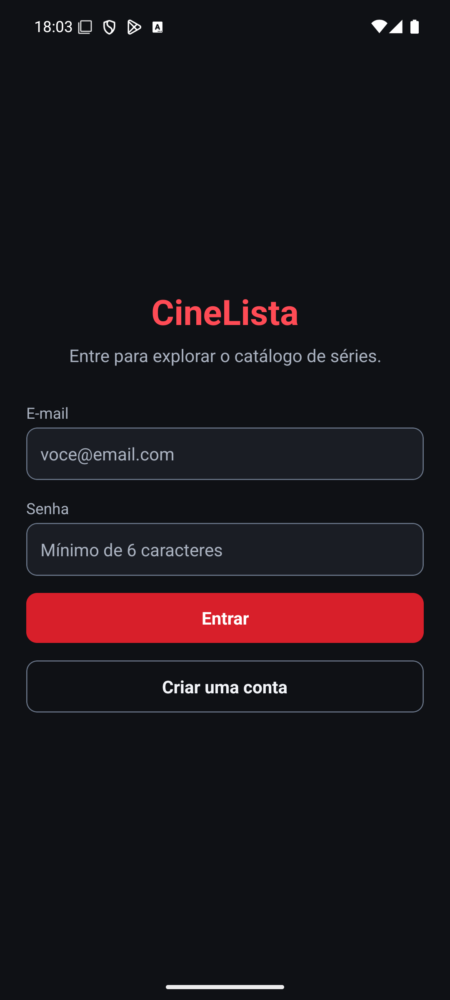
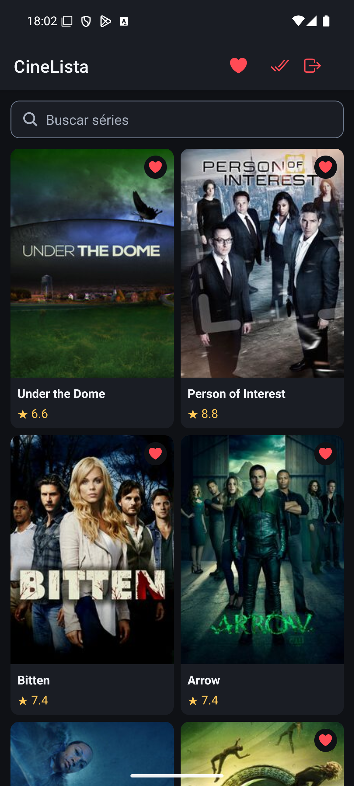
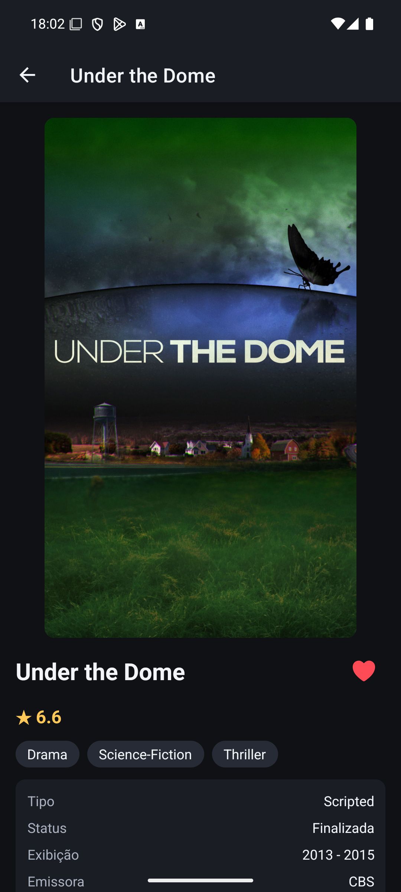
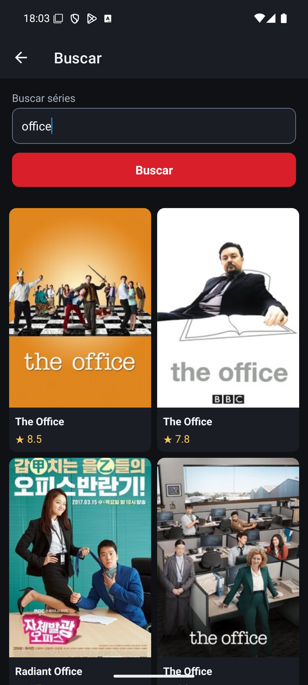
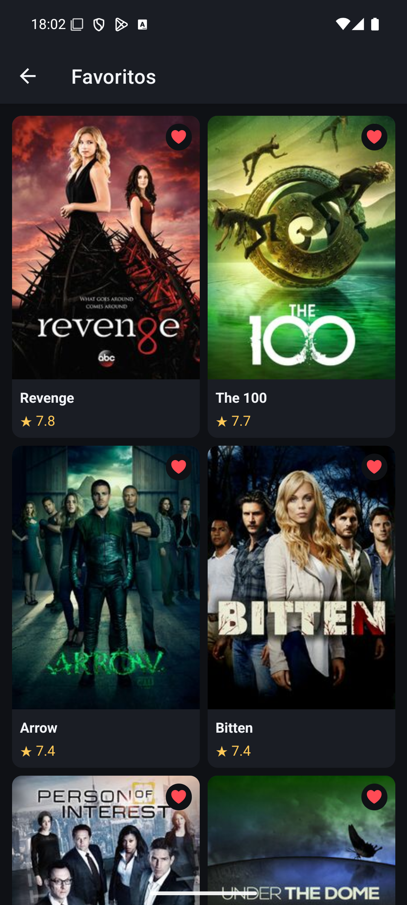
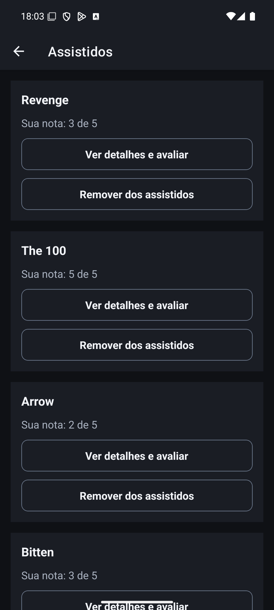

# Rascunho do PDF de entrega (issue #12)

Fonte para montar o PDF único enviado pelo **campo oficial** do Canvas (não por comentário: -30%).
Cada item faltante = -20%. Itens `TODO` dependem do grupo.

---

## Capa
- **Disciplina:** Desenvolvimento Mobile Híbrido - Bacharelado em Sistemas de Informação (BSI)
- **Professor:** Mark Joselli
- **Turma:** 6º A - Sistemas de Informação (Noite) - 2026 / 2º Sem
- **Data de entrega:** 02/11/2026
- **Projeto:** CineLista - Catálogo Interativo 2.0 (catálogo de séries de TV)
- **Integrantes (nome completo, igual ao dito no vídeo; quem faltar leva ZERO):**
  - Eduardo Fabri (eduardofabrii)
  - João Pedro Cardoso de Liz (Jcliz)
  - João Vitor Correa Oliveira (jvecodev)
  - Rodrigo Alves (rdsalvesPUC)

## Seção 1 - Links
- **Repositório (público):** https://github.com/jvecodev/cinelist (README explica `npx expo start`)
- **Vídeo (YouTube, público):** https://www.youtube.com/watch?v=yni1ljT0eOc

## Seção 2 - Tema e Configuração
- **Tema:** catálogo de séries de TV
- **API:** TVMaze (https://www.tvmaze.com/api), pública e sem chave: `/shows?page=`, `/shows/:id`, `/search/shows?q=`
- **Persistência:** Local, com `@react-native-async-storage/async-storage` (RF06)
- **Login:** Local (RF07), com credenciais e sessão no `expo-secure-store`
- Tema diferente do somativo de Flutter: Sim (Flutter: música; React Native: cinema/séries)

## Seção 3 - Autoavaliação RF01-RF10
| RF | Implementado | Arquivo principal |
|---|---|---|
| RF01 Catálogo, FlatList e paginação | Sim | `src/screens/HomeScreen.tsx`, `src/hooks/useShows.ts` |
| RF02 Navegação | Sim | `src/navigation/RootNavigator.tsx` |
| RF03 Detalhes | Sim | `src/screens/DetailsScreen.tsx`, `src/utils/html.ts` |
| RF04 Favoritos com Context | Sim | `src/contexts/FavoritesContext.tsx` |
| RF05 Tela de favoritos | Sim | `src/screens/FavoritesScreen.tsx` |
| RF06 Persistência local | Sim | `src/hooks/usePersistentState.ts`, `src/services/storage.ts` |
| RF07 Login, sessão e consumidos | Sim | `src/contexts/AuthContext.tsx`, `src/services/localAuth.ts`, `src/screens/ConsumedScreen.tsx` |
| RF08 Busca | Sim | `src/screens/SearchScreen.tsx` |
| RF09 Feedback de UI | Sim | `src/hooks/useFetch.ts`, `src/components/LoadingView.tsx`, `src/components/ErrorView.tsx` |
| RF10 Acessibilidade | Sim | `src/theme/index.ts`, `src/hooks/useGridColumns.ts`, `docs/validacao-rf07-rf10.md` |

## Seção 4 - Flutter x React Native (meia página)
Comparamos os dois somativos da disciplina: o DataAudio, catálogo de músicas em Flutter, e o CineLista, catálogo de séries em React Native.

**Estado global (Provider × Context).** No DataAudio, cada domínio tem uma classe `ChangeNotifier`, registrada em um `MultiProvider`, e as telas observam as mudanças com `context.watch`. No CineLista, usamos `createContext` com um Provider e hooks próprios, como `useFavorites()`. O Provider separa melhor a lógica da interface e fica mais fácil de testar. O Context é nativo do React e exige menos estrutura, mas qualquer mudança no valor re-renderiza os componentes que o consomem.

**Listas (GridView × FlatList).** No Flutter, a grade usa `SliverGrid.builder`, construída sob demanda, e a próxima página é pedida por um botão "carregar mais". No React Native, a `FlatList` com `numColumns` já oferece virtualização, `onEndReached` e pull-to-refresh, e a rolagem infinita fica automática. Em compensação, exige atenção ao `keyExtractor` e ao `extraData` para atualizar os cards.

**Assincronismo (FutureBuilder × useEffect/useState).** No Flutter, o `FutureBuilder` trata de forma declarativa os estados de carregamento, erro e dado, e por isso o usamos em leituras pontuais, como os detalhes. No React Native, esses estados são controlados manualmente. Por isso criamos o hook `useFetch`, que também cancela requisições com `AbortController` quando a tela é fechada. Dá mais trabalho no início, mas o controle sobre o ciclo de vida é maior.

**Produtividade e ferramentas (hot reload × Fast Refresh/Expo Go).** Os dois atualizam a interface quase instantaneamente durante o desenvolvimento. O Expo Go facilitou o início, pois basta ler o QR code para abrir o app no celular, sem compilar o projeto nativo. O Flutter exige um ambiente mais completo, mas oferece um conjunto de widgets mais padronizado. O hook `useFetch` e os componentes próprios mostraram que, no React, parte da estrutura precisa ser construída pelo grupo.

## Seção 5 - Explicação Técnica
- **Tema:** Navegação condicional: como o `AuthContext` decide entre o Stack de login e o Stack do app, e por que não usar `navigation.navigate('Login')` no logout (`src/contexts/AuthContext.tsx`, `src/navigation/RootNavigator.tsx`, `App.tsx`)
- **Minuto no vídeo:** 5:30-8:00

## Seção 6 - Screenshots
- **Login:** 
- **Catálogo:** 
- **Detalhes:** 
- **Busca:** 
- **Favoritos:** 
- **Itens consumidos (Assistidos):** 

---

## Roteiro do vídeo (6 a 9 min; -5% por minuto fora)
Os tempos dos blocos são os do **roteiro obrigatório do item 7.3** do enunciado e não devem mudar. Cada integrante escreve o roteiro da própria fala.

| Tempo | Bloco | Quem |
|---|---|---|
| 0:00-0:30 | Apresentação: cada um diz o nome completo (igual ao da capa) | Todos |
| 0:30-2:00 | Demo: login, rolagem infinita, busca, detalhes, favoritos, assistidos, reabrir o app (persistência) | TODO |
| 2:00-2:50 | Código: RF01, RF02, RF03 | jvecodev |
| 2:50-3:40 | Código: RF04, RF05, RF06 | Jcliz |
| 3:40-4:30 | Código: RF07, RF10 | eduardofabrii |
| 4:30-5:20 | Código: RF08, RF09 | rdsalvesPUC |
| 5:20-5:30 | Folga | - |
| 5:30-8:00 | Explicação técnica (~35s por integrante, relacionando com o próprio código) | Todos |

Total previsto: cerca de 8 min, dentro do intervalo de 6 a 9 min.

## Checklist antes de enviar
- [ ] Repositório público
- [ ] Nenhum `.env` ou chave commitada
- [ ] Todos os nomes completos na capa
- [ ] Vídeo público entre 6 e 9 min
- [ ] PDF enviado pelo campo oficial até 02/11/2026 23:59
